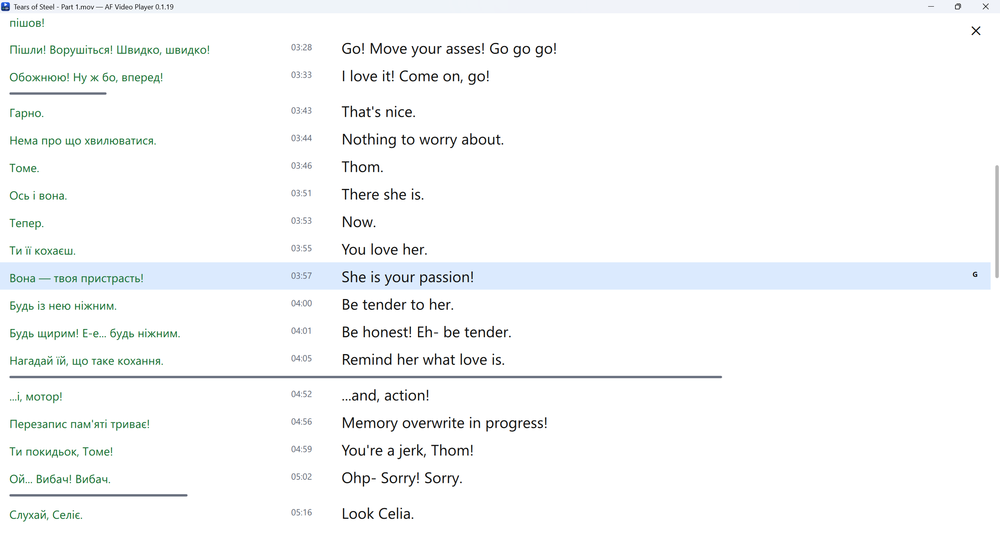
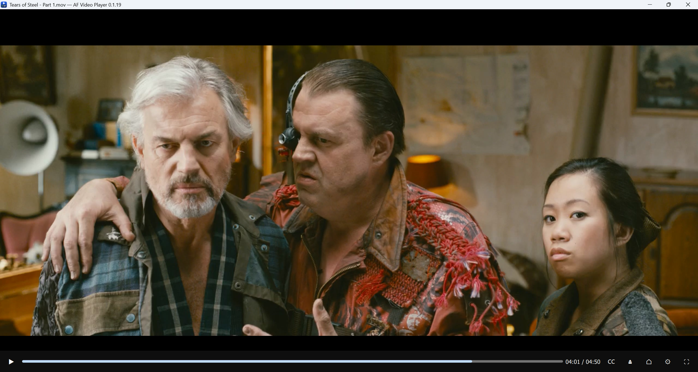
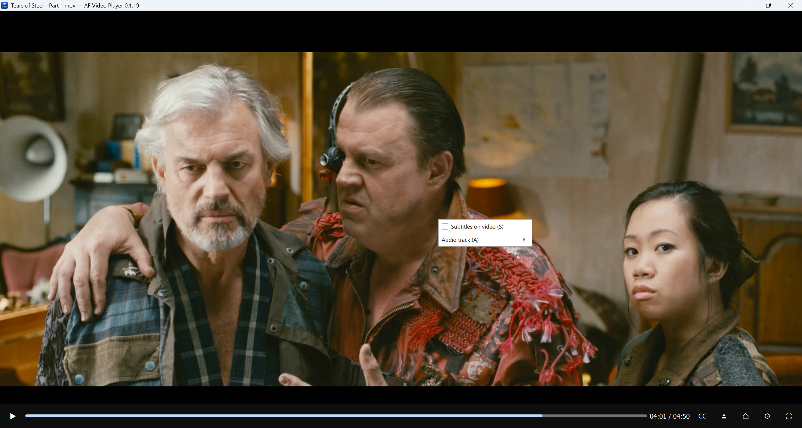
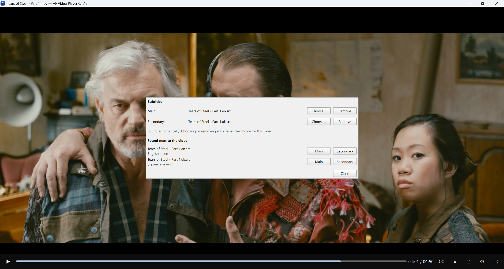
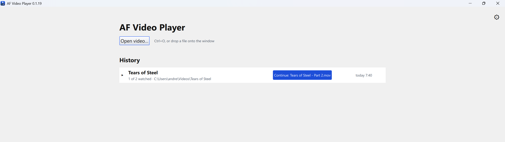
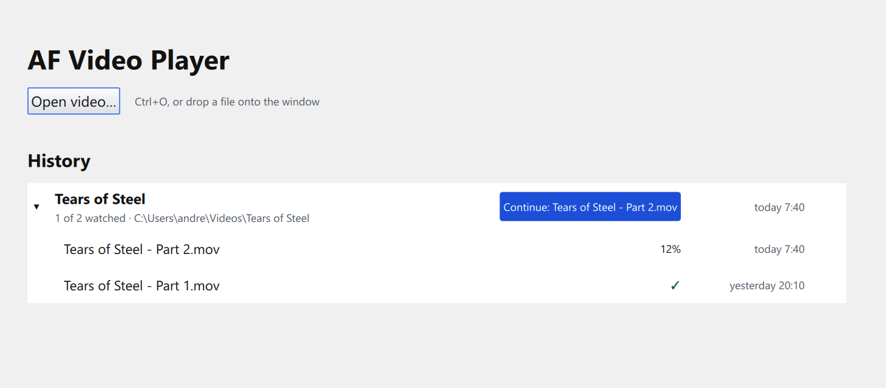
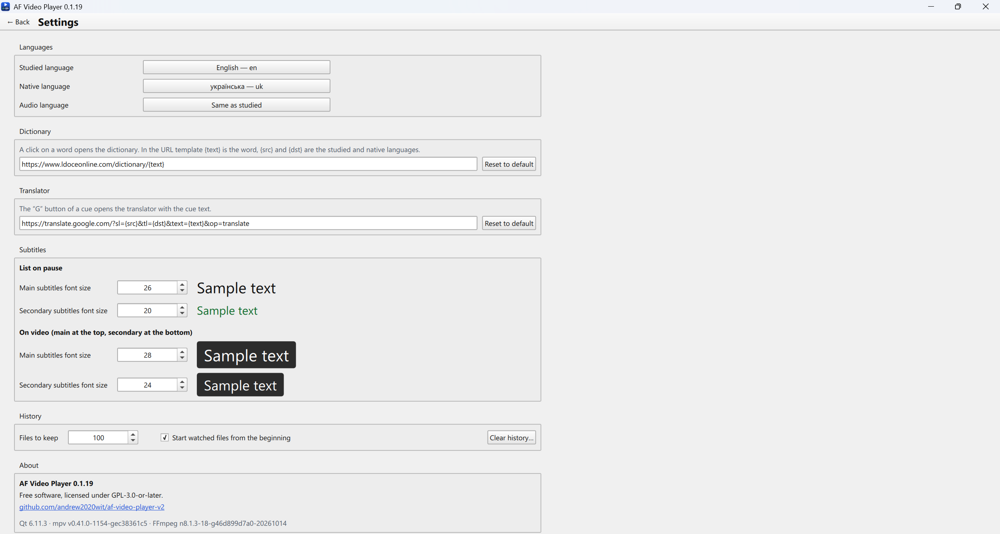

# Screenshots

[← README](README.md)

## The subtitle list

`Space` pauses the video and shows all cues in two columns: the translation on the left (green), the start time
and the original on the right. The current cue is highlighted. A click on a word opens the dictionary, the `G`
button translates the cue, a click on the time jumps to that moment of the video.

## Playback

The video fills the window; the control panel at the bottom hides when the mouse does not move. Subtitles are not
shown over the video by default.

A right click on the video opens the menu with subtitles on the video and the audio track.

## Choosing subtitles

The `CC` button opens the "Subtitles" dialog: the main (original) and secondary (translation) subtitle files and
the files found next to the video with their languages. For a video with embedded subtitles the dialog also has the
"Export embedded…" button.

## The start page

Opening a video and the history of watched files. Files of one folder are grouped as a series with the "Continue"
button.

An expanded series shows its files with the watched percentage.

## Settings

Languages, the dictionary and translator URLs, subtitle font sizes, the history and information about the player.

## Credits

The screenshots show [Tears of Steel](https://mango.blender.org/), (CC) Blender Foundation | mango.blender.org,
licensed under [CC BY 3.0](https://creativecommons.org/licenses/by/3.0/). For the screenshots the film is split
into two files to show a series. The English subtitles are the official ones; the Ukrainian subtitles are an
unofficial translation.
